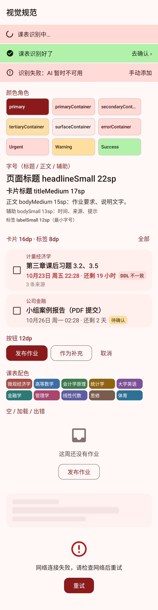
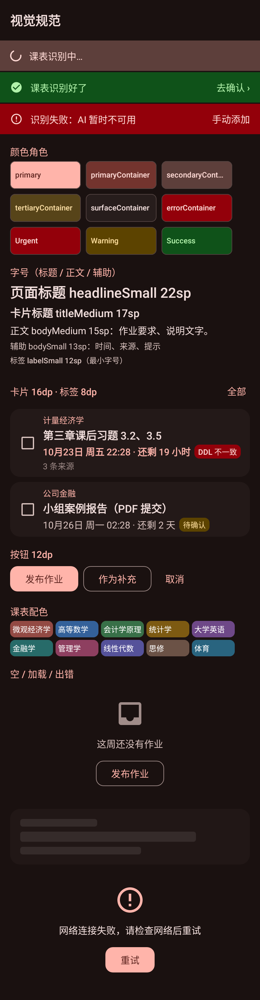

# swufe-homework Android

Kotlin + Jetpack Compose + Material 3，minSdk 26，只打 `arm64-v8a`。

## 结构
```
app/src/main/java/com/swufe/homework/
  data/api      Retrofit 接口（对照 docs/api.yaml）、模型、证书固定、鉴权与 401 续期
  data/local    DataStore（token、设置）、Room（课表缓存）
  data/repo     Auth / Account / Timetable / Update 仓库
  di            Hilt 模块
  ui/theme      视觉规范：颜色（含语义色、课表色）、字号、圆角、间距（见「视觉规范」）
  ui/common     通用组件：空/加载/出错状态、状态条、分组标题、确认弹窗
  ui/auth       登录、注册（校园网检测 + 邀请码）、恢复码展示、找回
  ui/timetable  课表网格、截图导入与确认、手动添加、班级页外壳
  ui/me         我的、设置、邀请码
  ui/homework   WS5：首页 feed、班级页内容（按周浏览作业、榜单）、发布/补充/编辑、作业详情、贡献值、提醒引导
  reminder      WS5：本地提醒（AlarmManager 定时、通知、标记完成、开机重建、WorkManager 同步）；WS10：后台识图通知
  ui/nav        路由与导航图（与 WS5 的约定见 NAVIGATION.md）
```

## 构建
需要 JDK 17、Android SDK 35。
```bash
cd android
./gradlew testDebugUnitTest lintDebug assembleDebug
# 产物：app/build/outputs/apk/debug/app-debug.apk
```

构建时注入的配置（**不要提交真实值**），变量名与 WS6 release workflow 统一，见 docs/workstreams.md「Android 构建环境变量」：

| 环境变量（或同名 Gradle 属性） | 用途 |
|---|---|
| `SERVER_BASE_URL` | `https://<IP>:8443/api/v1` |
| `SERVER_CERT_PIN` | `sha256/<base64>`，可逗号分隔多个 |
| `SIGNING_STORE_FILE` / `SIGNING_STORE_PASSWORD` / `SIGNING_KEY_ALIAS` / `SIGNING_KEY_PASSWORD` | release 签名 |
| `VERSION_NAME` / `VERSION_CODE` | 版本（与 tag `v<VERSION_NAME>` 对应，检查更新靠它比较） |

- **release fail-closed**：缺 pin、地址仍为默认 `127.0.0.1`、或缺签名配置时 `assembleRelease` 直接失败；运行时 release 下 pin 为空也会拒绝建立连接。
- debug 可以不配：pin 为空时退回系统 CA（只用于本地对接有正规证书的测试服务器）。
- 有 pin 时只接受叶子证书公钥匹配的证书，主机名用 OkHttp 默认校验（证书带 IP SAN）。

## 视觉规范
主题入口 `ui/theme/SwufeTheme`（不用动态取色）。**页面里不要再写 `Color(0x…)`、裸 `dp` 间距或自定义字号**，一律从下面取。

 

截图由 `DesignScreenshotTest` 渲染 debug 里的 `DesignShowcase`（也可在 Android Studio 里看它的 @Preview）：
`./gradlew testDebugUnitTest --tests '*DesignScreenshotTest' -Pscreenshots=screenshots`，产物在 `app/screenshots/`，复制到 `android/screenshots/`。
Robolectric 原生绘图只支持 x86_64 Linux / macOS / Windows；不传 `-Pscreenshots` 时这个测试被排除、不启动 Robolectric，CI 不受影响。

### 颜色角色（`MaterialTheme.colorScheme`）
以西财红 `#8B1A1A` 为浅色 primary，深色 primary 为 `#FFB4AA`；secondary 是偏灰暖红，tertiary 是金色。对比度由 `ThemeTest` 校验（正文 ≥ 7:1，其余文字 ≥ 4.5:1，outline ≥ 3:1，深浅模式都查）。

| 角色 | 用在哪 |
|---|---|
| `primary` / `onPrimary` | 主按钮、选中态、页面里最重要的一个操作；分组标题文字 |
| `primaryContainer` | 选中的筛选标签、强调块底色 |
| `secondaryContainer` | 次要强调、进行中状态条 |
| `tertiary*` | 少量点缀（如课代表、徽章），不要大面积用 |
| `surface` / `onSurface` | 页面底色与正文 |
| `surfaceContainerLow` → `Highest` | 卡片（Low）、输入区与骨架（Highest），层级越高越深 |
| `onSurfaceVariant` | 辅助文字（时间、来源、说明） |
| `outline` / `outlineVariant` | 边框、分割线；**不要**再拿 outline 当文字色写大段说明 |
| `error*` | 出错、删除等破坏性操作 |

语义色 `MaterialTheme.semantic`（`import com.swufe.homework.ui.theme.semantic`）：

| 语义 | 用在哪 | 文字/图标 | 标签底 + 字 |
|---|---|---|---|
| Urgent | 24 小时内截止、DDL 不一致 | `urgent` | `urgentContainer` + `onUrgentContainer` |
| Warning | 待确认（`ddl_uncertain`、识别拿不准） | `warning` | `warningContainer` + `onWarningContainer` |
| Success | 已完成、已开启、加分 | `success` | `successContainer` + `onSuccessContainer` |
| 核对高亮 | 需要用户核对的输入框/格子底色 | — | `ReviewHighlight`（字仍是 `onSurface`） |

课表色块：`CourseColors[Math.floorMod(classId, CourseColors.size)]`，块上文字 `OnCourseColor`（白）。深浅模式各一套，都对白字 ≥ 4.5:1。

### 字号（`MaterialTheme.typography`，任何字 ≥ 12sp）
| 级别 | 槽位 | 用在哪 |
|---|---|---|
| 标题 | `headlineSmall` 22 / `titleLarge` 20 / `titleMedium` 17 / `titleSmall` 15 | 页面大标题 / 顶栏 / 卡片标题 / 分组标题 |
| 正文 | `bodyLarge` 16 / `bodyMedium` 15 | 长段说明 / 列表与卡片正文 |
| 辅助 | `bodySmall` 13 / `labelLarge` 15 / `labelMedium` 13 / `labelSmall` 12 | 时间、来源、提示 / 按钮 / 小标题 / 标签 |

### 圆角与间距
- 圆角 `Corners`：卡片 `Card` 16dp、按钮 `Button` 12dp、标签 `Tag` 8dp、大面板 `Sheet` 24dp。`MaterialTheme.shapes` 已映射（Card/AlertDialog/TextField 自动生效）；
  **Material 3 按钮默认是胶囊形，`Button`/`OutlinedButton` 要传 `shape = Corners.Button`**。
- 间距 `Spacing`：`xs` 4、`sm` 8、`md` 12、`lg` 16、`xl` 24。页面左右边距 `lg`，表单页 `xl`；卡片内边距 `lg`（紧凑卡片 `md`）；列表项之间 `sm`～`md`；大区块之间 `xl`。

### 通用组件（`ui/common/`）
| 组件 | 什么时候用 |
|---|---|
| `LoadingState` | 首次加载、页面还没有内容时。默认居中进度；列表页传 `skeleton = true` 显示骨架行。已有内容再刷新用下拉刷新，不要整页换成它 |
| `EmptyState` | 加载成功但没有数据（或筛选后为空）：圆底图标 + 可选标题（`title`）+ 一句话 + 可选按钮（如「发布作业」）。文案写接下来能做什么。不要只放一行灰字 |
| `ErrorState` | 加载失败且没有可显示的旧内容：可选标题 + 写清原因 + 「重试」。有旧内容时用 Snackbar 或顶部 `StatusBanner(Error)` 提示，保留内容 |
| `StatusBanner` | 顶部状态条，跨页面的后台任务（识图）：`Progress` 进行中、`Success` 完成 +「去确认」、`Error` 失败 + 补救操作 |
| `InlineNotice` | 页面内的圆角提示块，语气同 `StatusBanner`（`BannerTone`），文字可换行、可带一个文字操作：注册页校园网检测、识图「可能被裁掉」+「再加一张」、「标黄的请核对」、公告生效时间等。不要再用一行彩色小字当提示 |
| `SectionHeader` | 列表里的分组小标题（今天 / 本周 / 设置分组），可带右侧「全部」等操作 |
| `ConfirmDialog` | 需要二次确认的操作；破坏性操作 `destructive = true`；要冷静期的（删除投票）传 `countdownSeconds`，按钮显示「确认删除（3）」 |
| `BackTopBar`、`FormColumn`、`LoadingButton`、`PasswordField`、`ErrorText` | 原有组件（`FormColumn`、`LoadingButton` 已改用 `Spacing` / `Corners`；`CenterLoading` 现等同 `LoadingState()`） |

在 `LazyColumn` 里放空/错状态时用 `item { EmptyState(..., fill = false) }`。

### 作业卡片与说明行（`ui/homework/HomeworkComponents.kt`）
- `AssignmentCard`：左侧 `DateStub` 日期票根（月 / 大号日 / 时刻；24 小时内截止用 Urgent 底，已完成变灰），右侧课程、标题、剩余时间与标签。首页、班级页、游客浏览共用；`onToggleDone = null` 时不显示勾选框。
- 说明信息不要用「·」拼成一行：时间与剩余时间用 `DdlLine`（分开排），署名用 `SourceByline`，其余用 `MetaTag` / `MetaTags` 标签。
- 按钮文字后面不加「›」「→」。
- 其他页面同样不用「·」拼说明：管理页的班级、用户、处罚、操作日志，贡献值明细，班级页头部，频道消息的昵称与时间，都拆成「主文字 + `MetaTags` / `SourceByline`」。
  管理弹窗里选班用 `ClassOption`（`ui/admin/AdminComponents.kt`）。
- 表单里的 DDL 预览（发布、编辑作业）直接用 `DdlLine`，和卡片、详情一致。

## 已实现（WS4）
- 注册：先 `/auth/campus-check`，非校园网要求邀请码；成功后强制展示恢复码，勾选「我已妥善保存」才能继续，屏蔽返回键。
- 注册后的 token 先放内存，确认已保存恢复码后才落盘（恢复码页被杀不会绕过确认）。
- 登录、用恢复码找回（展示新恢复码）、退出登录（带本机 refresh_token 只注销本机，并清本地缓存）。
- 401 自动续期：只有 refresh 返回 401 才登出，网络错误保留登录态。
- 设置：昵称、榜单匿名开关；我的邀请码：列表、复制、剩余名额、生成。
- 课表：周一到周五 × 12 节网格，作息取 `/meta`（离线用内置西财作息）。
- 导入：选 1–2 张截图 → 压缩上传 `/uploads` → `/ai/status` 在线才发 `parse_timetable`（只传 `attachment_ids`） → 1.5 秒轮询最多 2 分钟
  → 确认页逐条可改（课名、教室、星期、起止节；截断课名和被裁掉的起节标黄）→ `/timetable/import`，
  conflicts 留在确认页标红让用户改名重提。
- AI 离线时导入按钮置灰并提示「AI 暂时不可用，请手动添加」；手动添加可用 `/classes/search` 搜已有课一键填入。
- 班级页「不是我的班」→ `DELETE /me/classes/{id}`（服务端记住退出，重新导入不自动加回，可搜索手动加入）。
- 启动时检查 GitHub Releases latest（自动检查最多 6 小时一次，避免匿名 API 限额），版本更高则提示下载 APK。

## 已实现（WS5）
- 首页：`/feed` 跨课程按 DDL 升序；DDL 不一致（`ddl_conflict`）标红、`ddl_uncertain` 显示「待确认」；勾选或左滑标记完成；可切换显示已完成；下拉刷新。
- 班级页（填进 WS4 的 `ClassPageScreen` body）：按周浏览作业（`from`/`to` 为周一到周日，按 DDL 日期分组）；周榜 / 学期榜（匿名显示服务端给的「匿名同学」）、课代表；「发布作业」入口。
- 发布：粘贴文字、选图（最多 6 张，单张 ≤ 10 MB，上传前压到约 1 MB）。AI 在线时「智能识别」→ `parse_assignment` 草稿回填，`uncertain` 字段标黄；离线按钮置灰。
  新建必须填 DDL（api.yaml `AssignmentCreate` 要求 ddl 必填，有图片时同样必填）。
  发布前 `candidates` 查重，在线时再跑 `dedupe_review`（AI 认为同一份的排前面），用户选「作为补充」或「仍然新建」；在线时先跑 `spam_check`，可疑只提示本人。
- 作业详情：来源列表（首发/补充、昵称、时间、TA 看到的 DDL、缩略图点开全屏缩放）、谢谢、补充、编辑/删除自己的来源、提议合并（选同班另一条作业）、合并提议的赞同 / 首发者同意；
  删除投票：红色按钮 → 固定文案弹窗 → 确认按钮倒数 3 秒。
- 贡献值（v2 由「积分」改名，接口与变量名仍是 points）：「我的贡献值」（学期总分、今日已得 / 30、明细分页）、「贡献值规则」（`app/src/main/assets/points-rules.md` 的 `---` 之前部分；该文件是 `docs/points-rules.md` 的副本，单测校验两者一致，改规则时一起复制）。
- 提醒：`/sync` 增量同步写本地 Room 表 `assignment`（v2，只存标题、班级、DDL、完成、提醒文案）；每条未完成作业用 `setExactAndAllowWhileIdle` 设三次提醒：
  DDL 前 2 天 09:00、前 1 天 09:00、前 12 小时（Asia/Shanghai），已过的跳过，相隔不足 1 小时的合并（保留较晚那次）。
  通知文案优先 `reminder_text[2d|1d|12h]`，否则内置模板；点击进入作业详情；「标记完成」本地立即停止提醒，接口由 WorkManager 调（断网自动重试）。
  同步时机：每 4 小时（WorkManager，联网时）、打开 App、开机 / 升级 / 改时间或时区 / 准时提醒权限变化（同时重排提醒）。退出登录清空提醒、通知和同步游标。
- 首次进入主界面打开「提醒设置」引导：通知权限、准时提醒（系统里叫「闹钟和提醒」）、电池优化白名单；之后在「我的 → 提醒设置」。
  v2 去掉了自启动引导（requirements 十三.5）：部分国产系统重启手机后要打开一次 App 提醒才重新排好；开机广播重排提醒保留。
- 图片用带证书固定的 OkHttp 加载（Coil `ImageLoaderFactory`），相对 URL（`/files/...`）补成服务器地址。

## v2（WS10 PR②）
- **改名**：界面上「积分」→「贡献值」，「闹钟」→「提醒」（唯一例外是系统权限名「闹钟和提醒」，引导页按需求原文引用）。接口字段、路由、变量名不变。
- **后台识图**（requirements 十三.1）：`data/repo/AiJobTracker`（@Singleton，应用级 `CoroutineScope(SupervisorJob() + Dispatchers.IO)`）。
  - 只有 `parse_timetable`、`parse_assignment` 走它；`dedupe_review`、`spam_check` 仍同步等待。
  - `start()` 建任务后把 `{job_id, kind, context, created_at, …}` 存 DataStore（文件 `ai_jobs`，键 `pending_ai_jobs`），每 1.5 秒轮询到 `created_at + 150 秒`；同 kind 已有进行中的直接返回它。
  - App 启动（`SwufeApp` → `AiJobNotifier.start()` → `restore()`）恢复未过期的任务，过期的标超时并移除；已完成未取走的结果保留 24 小时。
  - 确认页（课表导入页、作业发布页）从 tracker 读结果后 `take()` 删除；用户放弃 `dismiss()`。作业草稿页需要的 class_id / assignment_id / source_id、识别前填的文字和已上传图片放 `context`（只存本机，不发服务器）。
  - 主界面顶部 `StatusBanner`；识别结束时前台弹 Snackbar、后台（`ProcessLifecycleOwner` 未到 STARTED）发「AI 识别」渠道通知，点通知经 `DeepLinks` 进确认页。
  - 不用 WorkManager / 前台服务：进程被杀期间不轮询，重开后接着查（服务器任务结束 24 小时内可查）。
- **课表导入确认页**：识别结果里有截断课名或 `start_visible=false` 时，页顶提示「截图上方/下方可能被裁掉，建议补截另一半一起识别」+「再加一张」（最多 2 张，与原图一起重新识别）。
- **「我的」处罚提示**：`/me` 的 `restrictions` 非空时显示「你被禁言/禁发到 X，原因：…」。
